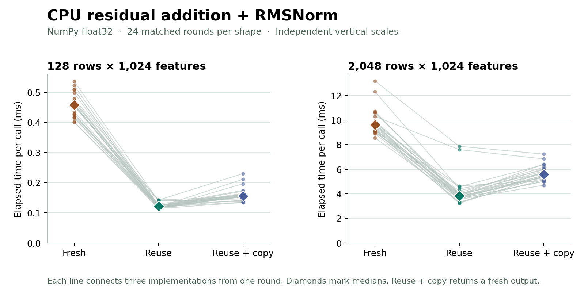

# 从分块归约到 RMSNorm 性能测量

这个作品研究一个具体问题：做相同的残差加法和 RMSNorm 时，复用临时数组能节省多少时间？如果调用方必须保留每次的输出，复制结果又要花多少时间？

课堂笔记从一块数据怎样进入 AI Core 讲起，接着用四块平方和、核函数启动和专家负载解释后面的实验。[阅读《AI 计算与昇腾算子开发》](docs/course-notes.md)

在本次 Windows CPU、NumPy 2.3.5、FP32 实验中，输入为 **2048 × 1024** 时，常规实现每次调用的中位耗时为 **9.61 ms**。复用缓冲区并返回独立输出为 **5.57 ms**，允许下次调用覆盖输出时为 **3.82 ms**。两种改写都通过了 FP64 参考值检查。

| 输入矩阵 | 新建临时数组 | 复用并返回缓冲区 | 复用并复制输出 |
| --- | ---: | ---: | ---: |
| 128 × 1024 | 0.457 ms | 0.122 ms | 0.155 ms |
| 2048 × 1024 | 9.613 ms | 3.821 ms | 5.569 ms |



**怎样读结果。** 如果下游要把上一次输出留给下一步使用，应比较“新建临时数组”和“复用并复制输出”。三种方案都从相同输入出发，差异反映整条 NumPy 实现的耗时，还涉及数组生存期、访问方式和缓存。图中两组使用独立纵轴。测量范围为 CPU 上的单个算子表达式，Qwen3-8B 在 NPU 上的耗时仍待采集。[全部原始计时](rmsnorm/observed.json)

## 复现 CPU 实验

从项目根目录运行，默认使用 Python 3.12。归约实验和推理结果分析器只依赖标准库，RMSNorm 实验另需 NumPy。

```console
python cpu/check_reduction.py
python -m pip install -r requirements.txt
python rmsnorm/compare.py --output local-results/cpu-rerun.json
python -B -m unittest discover -s inference -p "test_*.py"
```

**分块归约。** 四个逻辑块在单个 CPU 进程中依次计算，验证的是分块索引和归约逻辑。5 组覆盖课堂形状、手算例子、4097 行尾块、部分空块和空矩阵。4097 行实际被分成 1024、1024、1024、1025 行；每个元素恰好被计入一次。生成输入使用整数公式构造独立参考值。[验证代码](cpu/check_reduction.py) · [五组结果](cpu/results.json)

**残差加法与 RMSNorm。** 先计算 `z = x + residual`，再沿每行特征计算 `z / sqrt(mean(z²) + eps) × gamma`。输入固定，三种实现各先预热 5 次。每种形状测 24 轮，三种执行顺序的所有 6 种排列各出现 4 次。小矩阵每次观测取 10 次调用的平均耗时，大矩阵取 3 次。表中是各实现 24 次观测的中位数；复用方案的缓冲区在计时前分配，复制输出的开销计入第三种方案。使用 FP64 独立计算参考值，逐元素按 `rtol=2e-5, atol=2e-6` 比较。[实现和测量方法](rmsnorm/compare.py)

## 把同一问题带到昇腾 NPU

课程实践的问题是，短输入和长输入下启用 Dense RMSNorm 融合，对 Qwen3-8B 离线推理的影响分别有多大。这里提供结果分析器，读取上游 Notebook 的基线、融合、生成文本和比较文件。它会核对输入、实际 token 数和日志计时口径，质量检查通过后汇总可比轮次。目前完成了分析器的测试，NPU 性能一栏留待实机数据填写。[实验步骤和输入格式](inference/README.md) · [分析代码](inference/analyze.py)

## 来源和贡献

分块归约和昇腾融合对照的选题来自课程。CPU 实现、测量脚本、图表和结果分析器由 Codex 根据课堂主题生成，并在本机执行了 CPU 验证和分析器测试。基准表记录了这次执行结果。学习者后续复测、代码修改及 NPU 实机分析可分别用提交记录和原始结果说明。[上游课程固定版本](https://github.com/hicann/cann-learning-hub/tree/f38f0a09d95660e46f9816d6c6a058d67fb1416f/tutorials/llm_inference/qwen3_8b)
